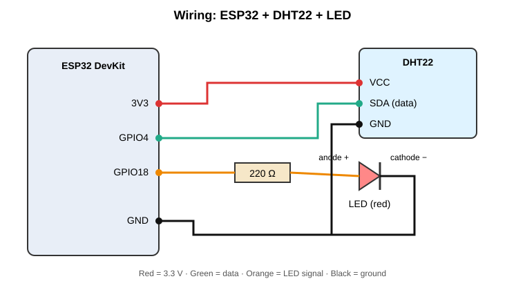

# Temperature Alert (ESP32 + DHT22 + LED)

Level 1 Embedded Systems & IoT: read one sensor, drive one output in response.

An ESP32 reads temperature from a DHT22 every 2 seconds. When it rises above
30 °C an LED turns on; it turns off again below 28 °C.

## Parts
| Part | Connection |
|---|---|
| ESP32 DevKit | – |
| DHT22 sensor | VCC → 3V3, SDA → GPIO4, GND → GND |
| Red LED + 220 Ω resistor | GPIO18 → resistor → LED anode; LED cathode → GND |

## Run it in the simulator (no hardware needed)
1. Go to [wokwi.com](https://wokwi.com) → New Project → **ESP32**.
2. Replace the contents of `sketch.ino`, `diagram.json` and `libraries.txt` with the files in this repo.
3. Click **Start**. Click the DHT22 and drag the temperature slider above 30 °C: the LED lights up and the serial monitor prints the reading.

## Run it on hardware
1. Wire the parts as shown above.
2. Install the Arduino IDE, add ESP32 board support, and install the **DHT sensor library** (Adafruit).
3. Open `sketch.ino`, select your ESP32 board and port, upload, and open the serial monitor at 115200 baud.

## Design decisions
- **2 s read interval:** the DHT22 cannot be read faster than about once every 2 seconds.
- **Hysteresis (30 °C on / 28 °C off):** stops the LED flickering when the temperature sits near the threshold.
- **`millis()` instead of `delay()`:** the loop is not blocked, so more tasks can be added later.
- **Failed reads are skipped:** if the sensor returns NaN, the LED keeps its previous state.
- **GPIO4 and GPIO18:** avoids the ESP32 boot-strapping pins.

## Files
- `sketch.ino`: firmware
- `diagram.json`, `libraries.txt`: Wokwi simulator setup
- `wiring-diagram.svg`: wiring diagram
